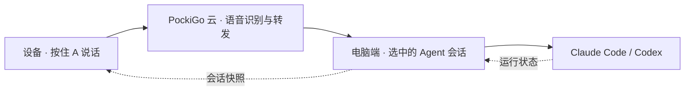

# 声钥 VibeMic

把 **PockiGo Card** 变成一台 Agent 语音输入外设：对着口袋说话，确认后的文字直接进入电脑上的 **Claude Code / Codex** 会话。

> 本仓库只提供**使用说明与安装包下载**，不包含源代码。

| 电脑端 | 设备端 |
| --- | --- |
|  |  |

设备端截图为离线布局预览，实际字体与像素以真机为准。

## 它是怎么工作的

设备不直接连接电脑。设备与电脑登录同一个 PockiGo 账号，云端负责会话快照、语音识别和文字暂存。

一个典型场景：

> 正在电脑上让 Codex 跑测试，离开工位时想补一句「先只跑单元测试」。掏出设备，选中那个会话，按住 A 说完、确认，文字就进了电脑上对应的对话框。

## 下载与安装

在 [Releases](../../releases) 页面选择对应系统和芯片的安装包。

| 电脑 | 安装包 |
| --- | --- |
| Windows x64 或 ARM64 | `声钥-Setup-<版本>-<arch>.exe` |
| Mac Apple 芯片（M1/M2/M3/M4） | `声钥-<版本>-arm64.dmg` |
| Mac Intel 芯片 | `声钥-<版本>-x64.dmg` |

- **Mac**：打开 DMG，把「声钥」拖入「应用程序」。
- **Windows**：双击 Setup 安装；SmartScreen 提示时选择「更多信息 → 仍要运行」。
- 安装包暂未使用 Apple Developer ID 签名和公证。macOS 首次打开请右键 App →「打开」，或到「系统设置 → 隐私与安全性」放行。
- Windows 版仍在验证中，遇到问题欢迎反馈。
- 手动升级前请先退出正在运行的声钥，再安装新版本。

**设备端**：在 PockiGo 的应用目录中安装「声钥」，并用同一个 PockiGo 账号登录。设备端版本会随 PockiGo 更新，无需使用本仓库的安装包。

## 使用前准备

- 一台 PockiGo Card（240×320 六键，兼容 Open Game Box）
- 一个 PockiGo 账号
- 安装好本仓库的声钥电脑端
- 电脑上已安装 **Claude Code** 或 **Codex（ChatGPT.app）**
- 电脑与设备都保持联网

## 连接设备与电脑

1. 在电脑上启动「声钥」，点左下角「登录 PockiGo」，在浏览器完成授权后返回。
2. 在绑定同一 PockiGo 账号的设备上打开「声钥」。
3. 在电脑端「我的设备」选中要同步的设备。一次同步一台；有多台时看设备名称末四位。
4. 到「设置 → Agent 状态」开启已安装、想同步的 Agent。

## 在设备上发送一条语音

1. 设备首页按上下键选中「当前会话」，左右键切换会话，按 **A** 确认。
2. 按住 **A** 说话，松开后等待识别，单次最长 10 秒。
3. 检查识别文字：**A** 确认发送，**B** 取消。
4. 设备显示「已送达电脑」后，电脑端对应会话即可收到文字。

## 从设备新建 Agent 会话

1. 设备首页默认选中「新建会话」，按 **A** 进入 Agent 选择。
2. 用上下键选择 Claude Code 或 Codex，按 **A** 确认。
3. 按住 **A** 说出第一条内容，确认后创建会话并投递。
4. Claude Code 会使用电脑端「创建会话」页配置的默认工作目录新开 Terminal 窗口；Codex 会在 ChatGPT.app 中新开聊天。

## 设备按键

| 操作 | 首页 | 会话列表 | 语音页 |
| --- | --- | --- | --- |
| 上下 | 切换「新建会话 / 当前会话」 | 选择会话 | 草稿翻页 |
| 左右 | 切换当前会话 | 切换 Claude / Codex 分组 | — |
| A | 新建会话 / 按住说话 | 确认选择 | 按住录音，松开识别；确认发送 |
| B 短按 | 进入会话列表 | 返回首页 | 取消 / 返回 |
| B 长按 | 退出到系统首页 | 退出到系统首页 | 退出到系统首页 |

## 版本与更新

- 当前版本：电脑端 `0.1.5`，设备端 `0.1.14`（2026-11-27）
- 每个版本的安装包见 [Releases](../../releases)，发布说明写在对应的 Release 中。
- 升级前请先退出正在运行的声钥。

## 常见问题

**设备上看不到会话。**
确认电脑端和设备登录的是同一个 PockiGo 账号；在电脑端「我的设备」选中这台设备；再到「设置 → Agent 状态」确认对应 Agent 已开启；电脑端需要保持运行。

**设备上有连接，但列表是空的。**
电脑上至少需要有一个 Claude Code 或 Codex 会话；没有 rollout 的 Codex 草稿线程不会显示。

**电脑端显示未登录或无法连接。**
确认网络正常，并升级到 Releases 中的最新版本；如果仍然失败，请在 Issues 中反馈版本号与提示文字。

**macOS 上发送了但会话没反应。**
到「设置 → 电脑权限」检查辅助功能与自动化授权。Terminal 投递需要允许「声钥」控制 System Events 和终端。

**设备上怎么退出应用？**
短按 B 进入会话列表，长按 B 退出到系统首页。

**语音识别失败或超时。**
单次录音最长 10 秒；确认设备和电脑联网后重试。

## 隐私与安全

- 电脑端只读取本地 Agent 的会话元数据（项目、标题、状态等），不读取对话正文。
- 录音只发送到 PockiGo 平台的语音识别服务；云端只暂存识别后的文字，送达即删除。
- 会话元数据会同步到云端用于设备展示，但不包含完整 prompt 或回复。
- 不修改用户已有的 Claude Code hooks。

## 反馈

请在 [Issues](../../issues) 中反馈问题，并附上：

- 声钥版本（电脑端 / 设备端）
- 操作系统与芯片
- 使用的 Agent（Claude Code / Codex）
- 复现步骤和界面提示
